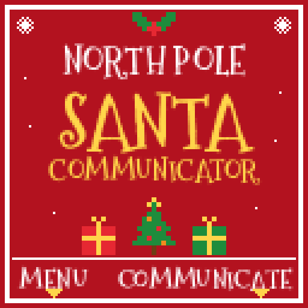
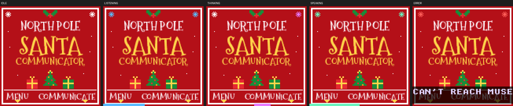

# 🎅 North Pole Santa Communicator

Turn an **AIPI Lite** into a little hotline to the North Pole. Hold the button,
ask Santa anything, and he answers out loud, powered by **Muse** for the
conversation and **ElevenLabs** for the voice.

<!-- PHOTO PLACEHOLDER: add a photo of the device lit up as docs/images/npsc/photo.jpg, then uncomment:

-->

<p align="center">
  
</p>

## What it does

- 🎄 **A full-screen Christmas design** in place of the usual avatar: red with a
  white border, holly, snowflakes, a tree and presents, with storybook lettering.
- 🔘 **Labeled buttons**: **MENU** on the left, **COMMUNICATE** on the right
  (hold it and talk), with little gold arrows pointing at each.
- ❄️ **Snowflakes that show the state**: blue while listening, pink while
  thinking, green while Santa speaks, red on an error.
- 🗣️ **Voice-only replies**: Santa talks, and the screen stays on the picture.
  Error messages such as `CAN'T REACH MUSE` still show, so you know when
  something's wrong.



## Hardware

- **AIPI Lite** (ESP32-S3, 8 MB PSRAM, 16 MB flash, 128×128 ST7789 screen, two buttons)
- A USB-C cable

## What you need

- [ESP-IDF](https://docs.espressif.com/projects/esp-idf/) v6.0 or newer
- A **Muse Gadget SDK token** (`mgst_…`) from
  [gadgets.muse.ai › SDK tokens](https://gadgets.muse.ai/settings/sdk-tokens)
- An **ElevenLabs API key** (`sk_…`) from
  [elevenlabs.io › API keys](https://elevenlabs.io/app/settings/api-keys).
  Give it the **Text to Speech** permission, or Santa stays quiet (you'd see a 401 in the log).
- An **ElevenLabs voice ID** for Santa. Pick or add a jolly voice in your
  [voice library](https://elevenlabs.io/app/voice-library), add it to *My Voices*
  (otherwise you get a 404), and copy its ID.

## Add your own secrets

Nothing secret lives in this repo. Put yours in `secrets/` (one line per file,
gitignored) or in environment variables:

| File in `secrets/` | Environment variable | What |
|---|---|---|
| `muse_sdk_token` | `MUSE_SDK_TOKEN` | Muse Gadget SDK token |
| `elevenlabs_api_key` | `ELEVENLABS_API_KEY` | ElevenLabs key with Text to Speech |
| `elevenlabs_voice_id` | `ELEVENLABS_VOICE_ID` | Your Santa voice's ID |

```sh
echo 'mgst_…'        > secrets/muse_sdk_token
echo 'sk_…'          > secrets/elevenlabs_api_key
echo 'YOUR_VOICE_ID' > secrets/elevenlabs_voice_id
chmod 600 secrets/*
```

Environment variables win over the files. See [`secrets/README.md`](secrets/README.md).

> ⚠️ The secrets end up inside the firmware image and the `build-*/` folder.
> Never share either one. If a key leaks, revoke it and build again.

## Build

From `esp32/`, with ESP-IDF activated (`. $IDF_PATH/export.sh`):

```sh
cd esp32
python3 tools/muse/secrets.py build-muse-aipi/sdkconfig && \
idf.py -B build-muse-aipi -DIDF_TARGET=esp32s3 \
  -DSDKCONFIG=build-muse-aipi/sdkconfig \
  -DSDKCONFIG_DEFAULTS="sdkconfig.defaults;devices/sdkconfig.muse;devices/sdkconfig.muse-aipi" build
```

## Flash

Plug in the AIPI Lite and find its serial port (`/dev/ttyACM0` on Linux,
`/dev/cu.usbmodem…` on macOS, `COMx` on Windows). Then:

```sh
idf.py -B build-muse-aipi -DIDF_TARGET=esp32s3 \
  -DSDKCONFIG=build-muse-aipi/sdkconfig \
  -DSDKCONFIG_DEFAULTS="sdkconfig.defaults;devices/sdkconfig.muse;devices/sdkconfig.muse-aipi" \
  -p PORT flash
```

or with esptool alone, from `esp32/build-muse-aipi/`:

```sh
python -m esptool --chip esp32s3 -p PORT -b 460800 write-flash \
  --flash-mode dio --flash-freq 80m --flash-size keep \
  0x0 bootloader/bootloader.bin 0x10000 partition_table/partition-table.bin \
  0x1d000 ota_data_initial.bin 0x20000 muse-gadget.bin
```

Then pair it with Muse as the upstream docs describe ([`README.fork.md`](README.fork.md)).

## Change the screen

The design is drawn by [`design/make_screen.py`](design/make_screen.py) and
turned into C by `esp32/components/muse/avatar/make_art.py`:

```sh
pip install pillow
python3 design/make_screen.py path/to/MountainsofChristmas-Bold.ttf
cd esp32/components/muse/avatar && python3 make_art.py
```

Want the regular avatar back? Delete `esp32/components/muse/avatar/` and the
`CONFIG_MUSE_FULLSCREEN_ART=y` line in `esp32/devices/sdkconfig.muse-aipi`.

## Credits

- [Muse Gadgets SDK](https://github.com/facebookincubator/muse-gadget-sdk) by
  Meta Platforms, Inc. and affiliates, Apache License 2.0
- [waveshare-muse-gadget-sdk](https://github.com/wupsbr/waveshare-muse-gadget-sdk),
  the fork this builds on (ElevenLabs replies, secrets tooling), Apache License 2.0
- [Mountains of Christmas](https://fonts.google.com/specimen/Mountains+of+Christmas)
  by Tart Workshop, SIL Open Font License 1.1 (used to draw the screen; not included)
- Our additions (the Christmas screen and `CONFIG_MUSE_FULLSCREEN_ART`) are
  Apache License 2.0, like the rest. See [`LICENSE`](LICENSE) and [`NOTICE`](NOTICE).
- The Jollybot avatar in `esp32/avatar/` is Meta's character and **not** covered by
  the Apache License; it's carried over unchanged from upstream (see `NOTICE`).

## Disclaimer

A fan-made holiday project. Unofficial, and not affiliated with or endorsed by
Meta, Muse, ElevenLabs, Waveshare or the AIPI Lite's maker. Santa's answers come
from an AI, so keep a grown-up nearby for little ones. 🎁
